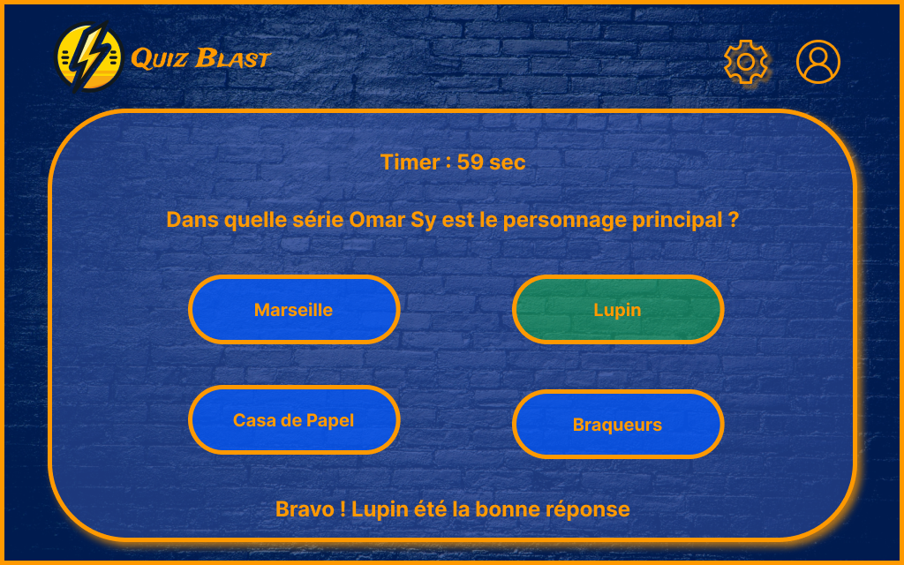
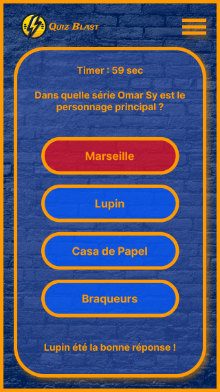
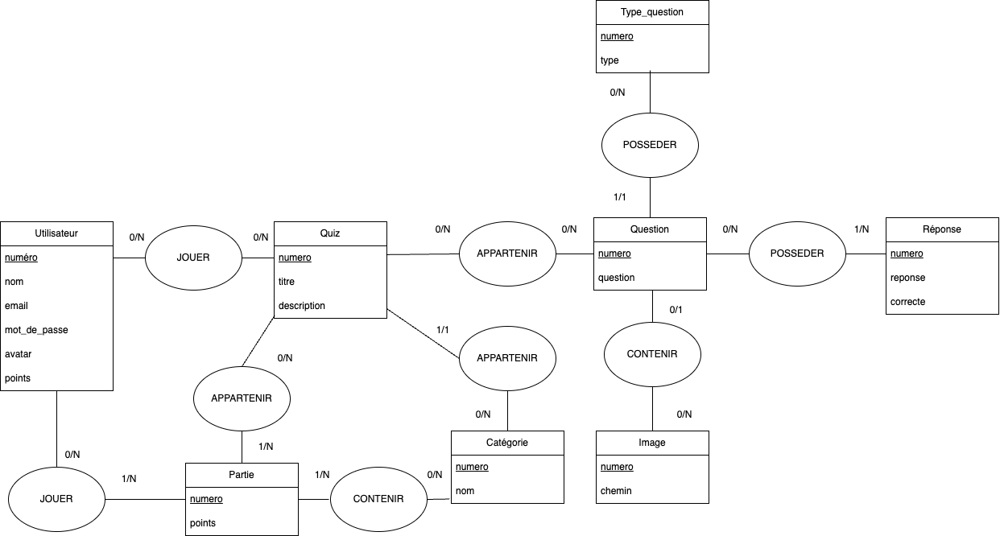
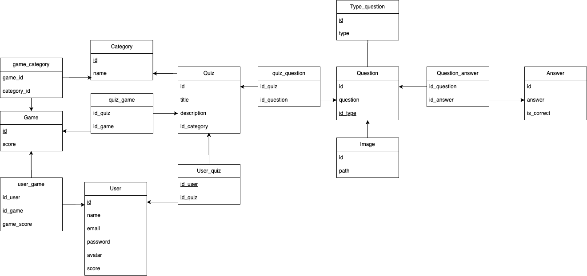

# quiz-blast-api

## Qu'est ce que quiz blast ?

Quiz blast est un quiz, qui peux se jouer seul ou à plusieurs. Différentes catégories sont disponibles : Histoire, Musique, Films & Séries, Faune & Flore... 

## Analyse du besoin

## User story
### En tant que joueur occasionnel :

- Je veux pouvoir participer à des quiz sur des sujets variés pour me divertir et apprendre de nouvelles choses.

- Je veux pouvoir jouer seul ou avec des amis pour m'amuser et créer une ambiance conviviale.

- Je veux que l'interface soit simple et intuitive pour pouvoir commencer à jouer rapidement.

- Je veux pouvoir voir mes résultats à la fin du quiz pour évaluer mes connaissances.

### En tant que joueur compétitif :

- Je veux pouvoir participer à des quiz en ligne avec d'autres joueurs pour tester mes connaissances et me mesurer à eux.

- Je veux pouvoir voir mon classement par rapport aux autres joueurs pour savoir où je me situe.

- Je veux pouvoir gagner des points ou des récompenses en fonction de mes performances pour être motivé à jouer.

- Je veux pouvoir choisir le niveau de difficulté des questions pour adapter le jeu à mon niveau.

### En tant qu'organisateur de quiz :

- Je veux pouvoir créer mes propres quiz personnalisés pour animer des événements ou des formations.

- Je veux pouvoir choisir le type de questions (QCM, vrai/faux, etc.) pour varier les plaisirs.

- Je veux pouvoir ajouter des images ou des vidéos pour rendre les questions plus attractives.

- Je veux pouvoir suivre les résultats des participants pour évaluer leurs connaissances.
En tant qu'apprenant :

- Je veux pouvoir utiliser des quiz pour réviser des notions apprises en cours.

- Je veux pouvoir obtenir des explications détaillées pour les réponses incorrectes afin de mieux comprendre.

- Je veux pouvoir suivre ma progression au fil du temps pour voir mes améliorations.

- Je veux pouvoir choisir les thématiques des quiz en fonction de mes besoins d'apprentissage.

### En tant qu'utilisateur mobile :

- Je veux pouvoir jouer à des quiz sur mon smartphone ou ma tablette pour m'occuper pendant mes déplacements.

- Je veux que l'application soit optimisée pour les écrans tactiles pour une expérience de jeu fluide.

- Je veux pouvoir jouer hors ligne pour pouvoir m'amuser même sans connexion internet.

## Maquette
### Maquette ordinateur


### Maquette téléphone


## MCD / MLD

### MCD


### MLD


## Mise en place de l'espace de travail

### Configuration

- Création du projet Node.js

```bash
npm init -y
```

- Installation des dépendences
  - Sequelize orm (ORM pour interagit avec la base de données)
  - PG (Le pilote de la base de données)
  - TypeScript (Compilateur TypeScript)
  - ts-node (Pour exécuter du code TypeScript sous node)
  - dotenv (Pour gérer les variables d'environnement)
  - express (Pour créer l'API)
  - @types/node et @types/express (Définitions de types TypeScript pour Node.js et Express)
  - ts-node-dev (Pour redémarrer automatiquement le serveur lors des modifications de code)
  - ESLint (linter ESLint)
  - @typescript-eslint/parser (Un parser ESLint qui permet à ESLint de comprendre la syntaxe TypeScript)
  - @typescript-eslint/eslint-plugin (Un plugin ESLint qui contient des règles spécifiques à TypeScript)

```bash
npm install  sequelize pg pg-hstore typescript ts-node dotenv express
npm install -D @types/node @types/express typescript ts-node-dev
npm install -D eslint @typescript-eslint/parser @typescript-eslint/eslint-plugin
```

### Configuration TypeScript

```json
{
  "compilerOptions": {
    "target": "es2020",
    "module": "commonjs",
    "outDir": "./dist",
    "rootDir": "./src",
    "esModuleInterop": true,
    "strict": true,
    "skipLibCheck": true,
    "sourceMap": true
  },
  "include": ["src/**/*"],
  "exclude": ["node_modules"]
}
````

### Configuration ESLint

```bash
npx eslint --init

You can also run this command directly using 'npm init @eslint/config@latest'.
Need to install the following packages:
@eslint/create-config@1.6.0
Ok to proceed? (y) y


> quiz-blast-api@1.0.0 npx
> create-config

@eslint/create-config: v1.6.0

✔ How would you like to use ESLint? · problems
✔ What type of modules does your project use? · esm
✔ Which framework does your project use? · react
✔ Does your project use TypeScript? · typescript
✔ Where does your code run? · browser
The config that you''ve selected requires the following dependencies:

eslint, globals, @eslint/js, typescript-eslint, eslint-plugin-react
✔ Would you like to install them now? · No / Yes
✔ Which package manager do you want to use? · npm
☕️Installing...

added 93 packages, changed 1 package, and audited 350 packages in 3s

124 packages are looking for funding
  run `npm fund` for details

found 0 vulnerabilities
Successfully created /Applications/MAMP/htdocs/projets-developpement-web/quiz-blast-api/eslint.config.mjs file.
```

### Configuration Sequelize

```bash
npm install -D @types/sequelize
````
 - Dans un dossier src/models/ créer un fichier connection.ts

 ```typescript
import { Sequelize } from 'sequelize';
import * as dotenv from 'dotenv';
dotenv.config();

const sequelize = new Sequelize(process.env.DATABASE_URL!, {
  dialect: 'postgres',
  dialectOptions: {
    ssl: {
      require: true,
      rejectUnauthorized: false,
    },
  },
});

export default sequelize;
````

- Exemple de modèle Sequelize avec TypeScript

```typescript
// models/user.model.ts
import { DataTypes, Model } from 'sequelize';
import sequelize from '../utils/sequelize';

class User extends Model {
  public user!: string;
  public email!: string;
  public password!: string;
  public avatar: string | null;
  public score: number | null;
}

User.init(
  {
    user: {
      type: DataTypes.STRING,
      allowNull: false,
    },
    email: {
      type: DataTypes.STRING,
      allowNull: false,
    },
    password: {
      type: DataTypes.STRING,
      allowNull: false,
    },
    avatar: {
      type: DataTypes.STRING,
      allowNull: true,
    },
    score: {
      type: DataTypes.INTEGER,
      allowNull: true,
    },
  },
  {
    sequelize,
    tableName: 'user',
    timestamps: false,
  }
);

export default User;
````


